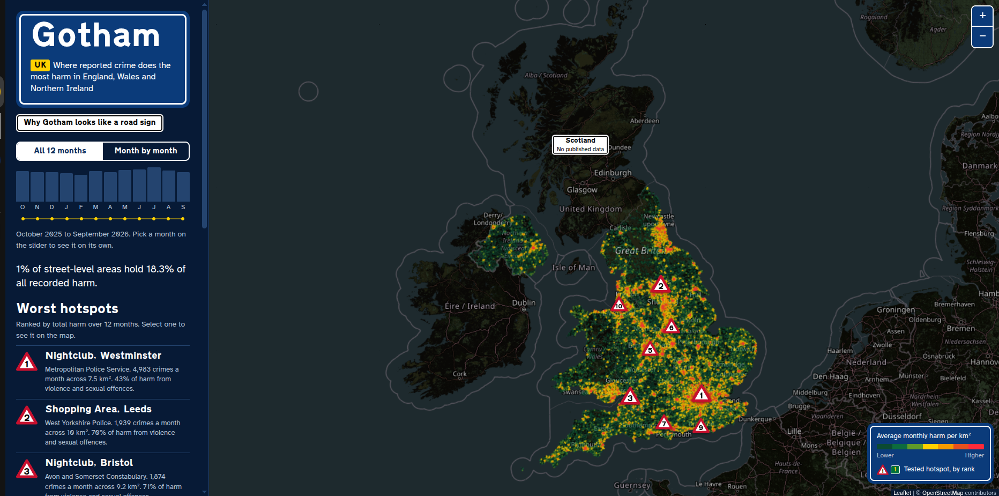
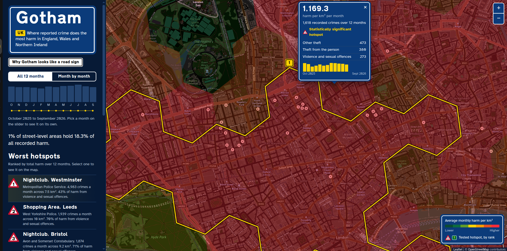

# Gotham

**Where reported crime does the most harm across England, Wales and Northern Ireland.**

**Live site: https://devom4rhl10.github.io/Gotham/**



Gotham is an interactive map of crime hotspots built from 12 months of open police data. Each crime is weighted by how serious it is, grouped into equal-area hexagons, and tested statistically, so the map shows areas where harm is unusually concentrated, not just where crime counts are high.

The site is fully static (HTML, CSS, JavaScript and JSON files). It has no server, costs nothing to host, and rebuilds itself every month from the latest police data.

> **AI disclosure:** the frontend of this project (everything in `site/`) was built with AI, using Claude by Anthropic, and the analysis method was developed with Claude's help. See [How AI was used](#how-ai-was-used) for details.

---

## Contents

- [Features](#features)
- [How it works](#how-it-works)
- [Do hotspots move over time?](#do-hotspots-move-over-time)
- [Design: British road signs](#design-british-road-signs)
- [Project structure](#project-structure)
- [Run it locally](#run-it-locally)
- [Deploy for free](#deploy-for-free)
- [Limitations](#limitations)
- [How AI was used](#how-ai-was-used)
- [Next steps](#next-steps)
- [Data and licences](#data-and-licences)

---

## Features

- **National view:** 1.6 km hexagons coloured by average monthly harm per km².
- **Street view:** zoom in and the map switches to 400 m hexagons, loaded only for the area you're looking at.
- **Fast:** built on Leaflet. Hexagons are drawn once per map tile, so panning just moves images around.
- **Tested hotspots:** marked with numbered warning triangles and outlined. Each passed a statistical test (Getis-Ord Gi\*), not just a visual threshold.
- **Readable at street level:** zoomed in, hexagons fade to a soft tint so street names stay visible.
- **Ranked list:** the worst hotspots, named by their most common street and area, from the top 10 up to 30. Select one to fly to it on the map.
- **Two views:** *All 12 months* ranks hotspots over the whole year. *Month by month* ranks them for each single month, with a slider you drag through the year, so you can see whether hotspots move.
- **Area details:** click any hexagon to see its harm, crime count, top crime types and a 12-month trend.
- **Honest about gaps:** forces that publish no data are labelled on the map instead of looking crime-free.
- **Works on phones:** on small screens the side panel becomes a bottom sheet.
- **Accessible:** keyboard controls for the map, visible focus, and reduced-motion support.

---

## How it works

```
data.police.uk bulk archive ──► Python pipeline ──► site/data/*.json ──► GitHub Pages
         (monthly)                runs in CI          small static files      free hosting
```

1. **Ingest.** Download the official monthly bulk archive from data.police.uk. It holds every street-level crime from every force, so nothing is missed. (The first version of this project queried the API around neighbourhood centroids, which left gaps in large rural areas and failed silently in dense cities.)
2. **Weight.** Multiply each crime by a harm weight, so a robbery counts for more than a shoplifting. Weights are set in `pipeline/config.py`. Anti-social behaviour is counted but not weighted.
3. **Bin.** Project coordinates to a Lambert azimuthal equal-area projection (the one Eurostat uses for its grids) and group crimes into hexagons, so every hexagon covers the same ground anywhere in the country.
4. **Test.** Run Getis-Ord Gi\* on each hexagon and its six neighbours. Correct for testing thousands of areas at once with the Benjamini–Hochberg procedure (1% false discovery rate).
5. **Group and rank.** Join neighbouring significant hexagons into zones, split very large zones into their densest cores, and rank zones by total harm.
6. **Rank each month too.** Repeat steps 4 and 5 for every single month, and count how many of each month's top 10 hotspots overlap the 12-month top 10.
7. **Check.** Measure how stable hotspots are from month to month (Jaccard overlap), how concentrated harm is (share in the top 1% of areas), and which forces published no data.

### Why not a clustering algorithm like HDBSCAN or K-means?

The first prototype used HDBSCAN on raw crime coordinates. Hotspot statistics turned out to be a better fit:

- Police coordinates are snapped to a fixed set of anonymous points, so thousands of crimes share identical locations. Density-based clustering behaves oddly on repeated points.
- Clustering counts every crime the same, while this project cares about harm.
- Clusters have no built-in test of whether they're real or just where lots of people are. Gi\* gives a significance level for every area.
- Clustering has no ground truth to evaluate against. The checks in step 7 can be measured and explained.

---

## Do hotspots move over time?

Switch the map to **Month by month** and drag the month slider. Under the month bars, Gotham shows how many of that month's top 10 hotspots are also in the 12-month top 10.

**Finding (October 2025 to September 2026): hotspots are persistent.**

- **76%** of hotspot cells stayed hotspots from one month to the next.
- In a typical month, **6 of the top 10** hotspots were also in the 12-month top 10, and never fewer than 5 (the range was 5 to 8).
- The top **1%** of street-level areas held **18.3%** of all recorded harm.

The core stays put, while the places near the edge of the top 10 rotate from month to month.

| Month | Top-10 overlap | | Month | Top-10 overlap |
|---|---|---|---|---|
| Oct 2025 | 8 of 10 | | Apr 2026 | 6 of 10 |
| Nov 2025 | 6 of 10 | | May 2026 | 5 of 10 |
| Dec 2025 | 6 of 10 | | Jun 2026 | 6 of 10 |
| Jan 2026 | 7 of 10 | | Jul 2026 | 7 of 10 |
| Feb 2026 | 6 of 10 | | Aug 2026 | 5 of 10 |
| Mar 2026 | 7 of 10 | | Sep 2026 | 7 of 10 |

The site rebuilds every month, so the live figures will drift a little from these. The current ones are always in [`data/meta.json`](https://devom4rhl10.github.io/Gotham/data/meta.json) (`top10_overlap` for each month, `stability` overall).

This matches a well-documented pattern in criminology, sometimes called the "law of crime concentration": a small share of places accounts for a large share of crime, and those places stay much the same over time.

---

## Design: British road signs

Gotham's look is borrowed from British road signs, the system designed by **Jock Kinneir** and **Margaret Calvert**. The site has a page about it: [Why Gotham looks like a road sign](https://devom4rhl10.github.io/Gotham/road-signs.html).



What I learned about it:

- **Who and when.** In 1957 the Ministry of Transport set up the Anderson Committee to sign the new motorways, and hired Kinneir with Calvert, his former student, as designers. The signs were tested on the Preston bypass in 1958 and used on the M1 in 1959. The Worboys Committee extended the system to every other road in its July 1963 report, and it became law on 1 January 1965.
- **Shape says what kind of sign it is.** Following a 1949 international agreement: triangles warn, circles give orders (red ring for "don't", blue for "do"), and rectangles inform.
- **Colour says what kind of road it is.** Blue for motorways, green with yellow road numbers for primary routes, and black on white for other roads.
- **A typeface for reading at speed.** Kinneir and Calvert drew Transport, a rounded typeface with details like the tails on the lowercase l and t, set in upper and lower case so words keep a recognisable shape.
- **The pictograms have stories.** The girl on the "children crossing" sign is based on a photo of Calvert as a child, and the cow on the farm-animals sign was Patience, from her relatives' farm in Warwickshire. Calvert was appointed OBE in 2016.

How Gotham uses it: hotspots are numbered warning triangles, the name sits on a motorway sign plate, harm runs from primary-route green through yellow to warning red, and notes about missing data are small white local signs.

Sources: [Design Museum](https://designmuseum.org/designers/jock-kinneir-and-margaret-calvert), [Transport (typeface)](https://en.wikipedia.org/wiki/Transport_(typeface)), [Worboys Committee](https://en.wikipedia.org/wiki/Worboys_Committee), [Margaret Calvert](https://en.wikipedia.org/wiki/Margaret_Calvert).

---

## Project structure

```
gotham/
├── pipeline/            # Python data pipeline
│   ├── config.py        # paths, hexagon sizes, harm weights, list of forces
│   ├── ingest.py        # reads the police bulk archive (or old API JSON files)
│   ├── grid.py          # equal-area projection and hexagon maths
│   ├── stats.py         # Gi*, false discovery rate control, zone grouping
│   ├── build.py         # writes the JSON files the site reads
│   └── __main__.py      # command-line entry point
├── site/                # static frontend (built with AI, see below)
│   ├── index.html
│   ├── road-signs.html  # "Why Gotham looks like a road sign"
│   ├── app.css
│   ├── app.js           # Leaflet map, layers, panel, popups, month-by-month view
│   ├── hexgrid.js       # hexagon maths, spatial index and tile drawing
│   ├── fonts/           # Transport Heavy and Atkinson Hyperlegible, self-hosted
│   ├── vendor/leaflet/  # Leaflet 1.9.4, self-hosted
│   └── data/            # generated by the pipeline, not committed
├── tests/               # pytest suite, including an end-to-end run on synthetic data
├── legacy/fetching/     # first prototype's API scraper, kept for history; not used by the pipeline
├── screenshots/         # README screenshots
├── .github/workflows/deploy.yml
└── requirements.txt
```

---

## Run it locally

Requires Python 3.10 or later.

```bash
python -m venv .venv
source .venv/bin/activate          # on Windows: .venv\Scripts\activate
pip install -r requirements.txt pytest

python -m pytest -q tests          # run the tests

python -m pipeline                 # download the latest archive (large, cached in .cache/) and build the data
python -m http.server -d site 8000 # then open http://localhost:8000
```

Other ways to build the data:

```bash
python -m pipeline --months 24                      # use more months
python -m pipeline --archive ~/Downloads/2025-11.zip # use an archive you already downloaded
python -m pipeline --json-dir path/to/old/data       # reuse crimes_YYYY-MM.json files from the old API scraper
```

---

## Deploy for free

The site is hosted on GitHub Pages and rebuilt by GitHub Actions, both free for public repositories.

1. Push this folder to a public GitHub repository.
2. In the repository, go to **Settings → Pages → Build and deployment** and set **Source** to **GitHub Actions**.
3. Push to `main`, or run the workflow by hand from the **Actions** tab.

The workflow runs the tests, downloads the police archive, builds `site/data/`, and publishes the site. It runs again automatically on the 3rd of every month, after police.uk releases new data. Pushes that only change Markdown files or `screenshots/`, like this README, skip the rebuild.

You don't need to store the raw data anywhere yourself: data.police.uk already hosts the archive. Before each build the workflow checks `crime-last-updated`; if police.uk hasn't published a new month, it reuses the archive from GitHub's Actions cache instead of downloading it again. (GitHub drops cache entries unused for 7 days, so the monthly run usually downloads fresh data anyway, which it needs to.) The generated `site/data/` folder is ignored by git.

---

## Limitations

- **Reported crime only.** The map shows crime that was reported and recorded by police. It is not a measure of all crime, or of anyone's personal risk.
- **No population or footfall adjustment.** City centres and shopping streets rank high partly because so many people pass through them.
- **Approximate locations.** police.uk moves each crime to the nearest of a fixed set of anonymous map points, so street-level detail is accurate only to about a street.
- **Missing areas.** Greater Manchester Police have not supplied data to police.uk since July 2019, so Greater Manchester appears empty. Police Scotland does not publish to police.uk, and the current archive contains no British Transport Police records, so Scotland appears empty.
- **Illustrative weights.** The harm weights are ordered roughly by sentencing severity, but they are not the official ONS Crime Severity Score.

---

## How AI was used

**The frontend was built with AI.** It was designed and written by Claude, Anthropic's AI model.

**The current method was developed by me, with Claude's help.** This covers the move to the police bulk archive, the equal-area hexagon grid, severity-weighted harm, the Getis-Ord Gi\* hotspot test with false discovery rate control, and the month-by-month stability analysis.

**My own work:** the original idea, data sourcing and first prototype (API scraper, neighbourhood boundaries and centroids, HDBSCAN clustering and a Leaflet map), plus reviewing, testing and deploying the final version.

---

## Next steps

- Divide harm by population (ONS mid-year estimates join on the archive's LSOA codes) to show rate as well as volume.
- Replace the illustrative weights with an official harm index.
- Extend to Europe: the grid already uses Eurostat's projection, so European data on the same grid could be added.

---

## Data and licences

- Crime data: [data.police.uk](https://data.police.uk/). Contains public sector information licensed under the [Open Government Licence v3.0](https://www.nationalarchives.gov.uk/doc/open-government-licence/version/3/).
- Basemap: © [OpenStreetMap](https://www.openstreetmap.org/copyright) contributors, darkened with a CSS filter.
- Map library: [Leaflet](https://leafletjs.com) (BSD-2-Clause), self-hosted in `site/vendor/leaflet/` with its licence.
- Fonts (self-hosted, see `site/fonts/README.md`):
  - **Transport Heavy**, from [AG Transport Heavy](https://github.com/smugpie/uk-ire-road-sign-fonts), derived from the Department for Transport's drawings (Crown Copyright, Open Government Licence).
  - **Atkinson Hyperlegible** by the Braille Institute (SIL Open Font License).
